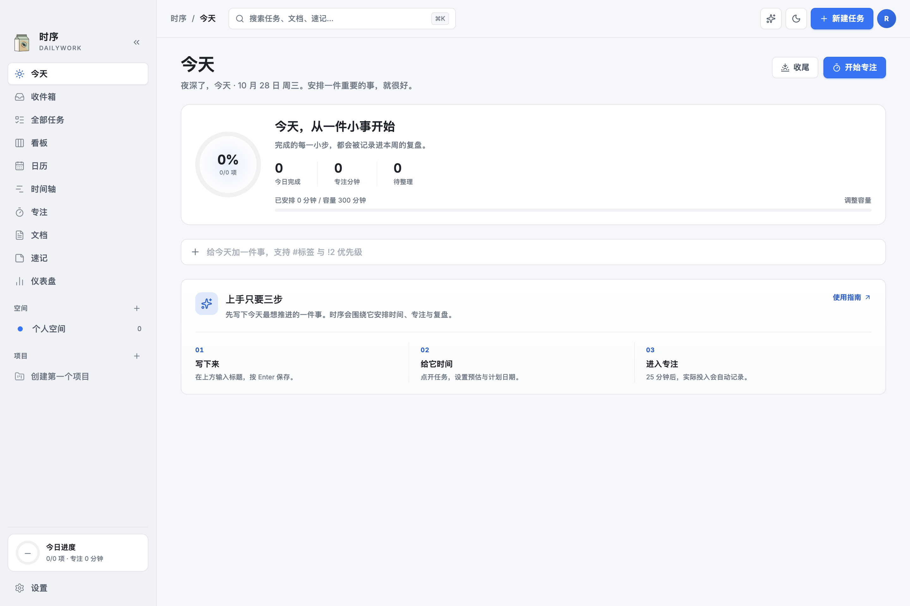

# 时序 · Dailywork

> 时间有序，专注有度。

时序是一款个人任务与知识工作台：任务、项目、看板、日历、时间轴、专注计时、flomo 式速记、块级文档与数据仪表盘，数据统一保存在 SQLite 数据库中，不依赖第三方账号。



## 是什么

- **一个闭环**：捕获 → 规划 → 执行（专注）→ 复盘 → 洞察。
- **不是又一个待办清单**：任务与时间、容量、专注、文档互相咬合；今天页回答「现在做什么」，仪表盘回答「最近怎么样」。
- **账户**：注册 / 登录 / 修改密码 / 头像（默认使用用户名首字母），每个账户拥有独立数据与设置。
- **版本记录**：设置 → 关于可查看每个版本的更新内容；每次发布同步更新应用内记录与 CHANGELOG。
- **数据自有**：SQLite 数据库；图片以 BLOB 存库并按 sha256 去重；支持 `.dailywork` 导出/导入，随时带走全部数据。
- **为 AI 而设计**：所有界面操作都收敛为一套 ops 契约，同时暴露 HTTP、CLI 与 MCP，AI 与人类走同一套规则。
- **克制的设计**：冷白画布、经典蓝强调色、单一字体家族、极浅阴影；支持强调色 / 语义色 / 中性色温自定义与深浅主题。

## 快速开始

要求：macOS（Apple Silicon 或 Intel）、Node.js ≥ 22.5、pnpm 10。

```bash
pnpm install
pnpm dev
```

`pnpm dev` 会同时启动服务（47821）、Vite（5173）与 Electron 桌面窗口。只开发浏览器界面时：

```bash
pnpm dev:server
pnpm dev:web
```

然后打开 http://localhost:5173。

### 常用命令

| 命令 | 说明 |
|---|---|
| `pnpm dev` | 服务 + Web + Electron 桌面壳 |
| `pnpm build` | 构建 Web / 服务 / CLI |
| `pnpm build:desktop` | 构建并打包 macOS dmg（ad-hoc 签名） |
| `pnpm test` | Vitest 单元与集成测试 |
| `pnpm test:e2e` | Playwright 核心旅程（自动启动服务与 Web） |
| `pnpm typecheck` | TypeScript 全量类型检查 |
| `pnpm lint` | ESLint |
| `pnpm daily -- task list` | 通过 CLI 操作服务 |

## 数据在哪

默认目录：`~/Library/Application Support/Dailywork/`

- `data.sqlite`：唯一权威数据（任务、项目、文档正文、图片 BLOB、审计日志）。
- `backups/`：每日快照与手动备份。
- `logs/`：结构化运行日志（不含任务正文与密钥）。

账户数据位于 `users/<id>/data.sqlite`（每个账户独立），账户、密码哈希、头像与会话位于 `accounts.sqlite`。数据目录可用环境变量 `DAILYWORK_DATA_DIR` 覆盖；测试使用临时目录。

## 技术架构

Electron 45 + React 19 + TypeScript 单栈；Hono 服务运行在 utilityProcess；SQLite（`node:sqlite`，WAL）；DDD 纵向切片；统一 ops 目录生成 HTTP / CLI / MCP / AI 工具四个表面。

```
apps/
  desktop/   Electron 主进程、preload、打包
  server/    Hono 服务（领域唯一写入口）
  web/       React SPA
  cli/       daily 命令行（HTTP 客户端 + MCP Server）
packages/
  contracts/ 共享 zod schema 与 DTO
  platform/  SQLite、迁移、路径、时间、密钥、日志
  contexts/  workspace / tasking / projects / capture / planning / focus / documents / assistant
  ops/       操作目录与执行器
  analytics/ 只读投影：仪表盘、搜索
docs/        PRD、架构、设计系统、ADR、流程文档
design/      品牌标识、架构图、设计稿与参考图
```

详细设计见 [docs/01-architecture/overview.md](docs/01-architecture/overview.md)，决策记录见 [docs/03-adr](docs/03-adr)。飞书归档：[时序 · Dailywork 文档库](https://my.feishu.cn/wiki/HjuOwAe34iZPbmkzOJhcMYK1nb4)。

## 项目状态

**v0.2.0 · 可验收**。核心闭环已经打通：任务 / 项目 / 看板 / 四象限 / 日历 / 时间轴 / 专注 / 速记 / 文档 / 仪表盘 / AI 助理 / CLI / MCP / 局域网配对 / 备份导出导入。安装包：`apps/desktop/release/Dailywork-0.2.0-arm64.dmg`。进度与已知限制见 [CHANGELOG](docs/04-process/CHANGELOG.md)。

### 验收路径（5 分钟）

1. 打开 dmg，把「Dailywork」拖进 Applications（ad-hoc 签名，首次打开如被拦截请右键 → 打开）。
2. 首次启动会看到「今天」与三步上手引导；在输入框写下任意一件事并回车。
3. 点开任务，设置预估 / 计划时间，点「开始专注」；结束后任务会记录实际投入。
4. 打开「文档」，阅读《欢迎使用时序》；打开「仪表盘」查看趋势；按 `⌘K` 搜索刚创建的任务。
5. 设置 → 数据与备份 → 导出备份；设置 → 通用 → 局域网访问，用手机浏览器打开地址并输入配对码；需要离线 PWA 时在同页生成 HTTPS 证书。

设计证据：`design/qa/auth-register.png`、`design/qa/account-settings.png`、`design/qa/blue-today.png`、`design/qa/matrix.png`、`design/qa/dark-today.png`、`design/qa/mobile-today.png`、`design/qa/ai-streaming.png`、`design/qa/doc-ai-menu.png`。

### 质量

- Vitest：54/54（纯单元 + 集成/路由），覆盖日期、参数解析、Ops 不变量、流式解析、备份、撤销、账户/会话/头像与 AI 护栏。
- Playwright：11/11（setup 账户 + 桌面 Chrome + WebKit iPhone 13 + 账户 UI），含注册/默认头像/上传/登录、创建、编辑、完成、速记转任务、文档重载、搜索、主题与移动布局。
- 打包冒烟：dmg 挂载启动、首启引导、任务持久化、局域网配对、配对 cookie 跨重启、HTTPS 证书、任务撤销。

## 许可

个人项目，未公开授权。
