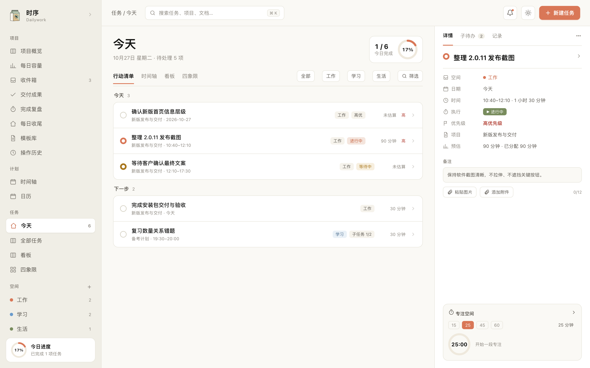

# 时序 · Dailywork

> 时间有序，专注有度。

时序是一款**本地优先**的个人任务与知识工作台：任务、项目、看板、日历、时间轴、专注计时、flomo 式速记、块级文档与数据仪表盘，数据全部存放在本机 SQLite，不依赖任何云账号。



## 是什么

- **一个闭环**：捕获 → 规划 → 执行（专注）→ 复盘 → 洞察。
- **不是又一个待办清单**：任务与时间、容量、专注、文档互相咬合；今天页回答「现在做什么」，仪表盘回答「最近怎么样」。
- **本地优先**：SQLite 单文件数据库；图片以 BLOB 存库并按 sha256 去重；支持 `.dailywork` 导出/导入，随时带走全部数据。
- **为 AI 而设计**：所有界面操作都收敛为一套 ops 契约，同时暴露 HTTP、CLI 与 MCP，AI 与人类走同一套规则。
- **克制的设计**：暖米白画布、陶土橙强调色、单一字体家族、极浅阴影；支持强调色 / 语义色 / 中性色温自定义与深浅主题。

## 快速开始

要求：macOS（Apple Silicon 或 Intel）、Node.js ≥ 22.5、pnpm 10。

```bash
pnpm install
pnpm dev
```

`pnpm dev` 会同时启动本地服务（47821）、Vite（5173）与 Electron 桌面窗口。只开发浏览器界面时：

```bash
pnpm dev:server
pnpm dev:web
```

然后打开 http://localhost:5173。

### 常用命令

| 命令 | 说明 |
|---|---|
| `pnpm dev` | 服务 + Web + Electron 桌面壳 |
| `pnpm build` | 构建 Web / 服务 / CLI |
| `pnpm build:desktop` | 构建并打包 macOS dmg（ad-hoc 签名） |
| `pnpm test` | Vitest 单元与集成测试 |
| `pnpm test:e2e` | Playwright 端到端测试 |
| `pnpm typecheck` | TypeScript 全量类型检查 |
| `pnpm lint` | ESLint |
| `pnpm daily -- task list` | 通过 CLI 操作本地服务 |

## 数据在哪

默认目录：`~/Library/Application Support/Dailywork/`

- `data.sqlite`：唯一权威数据（任务、项目、文档正文、图片 BLOB、审计日志）。
- `backups/`：每日快照与手动备份。
- `logs/`：结构化运行日志（不含任务正文与密钥）。

数据目录可用环境变量 `DAILYWORK_DATA_DIR` 覆盖；测试使用临时目录。

## 技术架构

Electron 45 + React 19 + TypeScript 单栈；Hono 本地服务运行在 utilityProcess；SQLite（`node:sqlite`，WAL）；DDD 纵向切片；统一 ops 目录生成 HTTP / CLI / MCP / AI 工具四个表面。

```
apps/
  desktop/   Electron 主进程、preload、打包
  server/    Hono 本地服务（领域唯一写入口）
  web/       React SPA
  cli/       daily 命令行（HTTP 客户端 + MCP Server）
packages/
  contracts/ 共享 zod schema 与 DTO
  platform/  SQLite、迁移、路径、时间、密钥、日志
  contexts/  workspace / tasking / projects / capture / planning / focus / documents / assistant
  ops/       操作目录与执行器
  analytics/ 只读投影：仪表盘、搜索
docs/        PRD、架构、设计系统、ADR、流程文档
design/      品牌标识、架构图、设计稿与参考图
```

详细设计见 [docs/01-architecture/overview.md](docs/01-architecture/overview.md)，决策记录见 [docs/03-adr](docs/03-adr)。飞书归档：[时序 · Dailywork 文档库](https://my.feishu.cn/wiki/HjuOwAe34iZPbmkzOJhcMYK1nb4)。

## 项目状态

v0.1.0 开发中。已完成：行走骨架、领域与存储内核、任务 / 项目 / 计划 / 专注 / 文档 / 仪表盘 / 速记 / 设置界面、CLI。进行中：AI、局域网 PWA、导出导入、打包发布。进度见 [CHANGELOG](docs/04-process/CHANGELOG.md)。

## 许可

个人项目，未公开授权。
