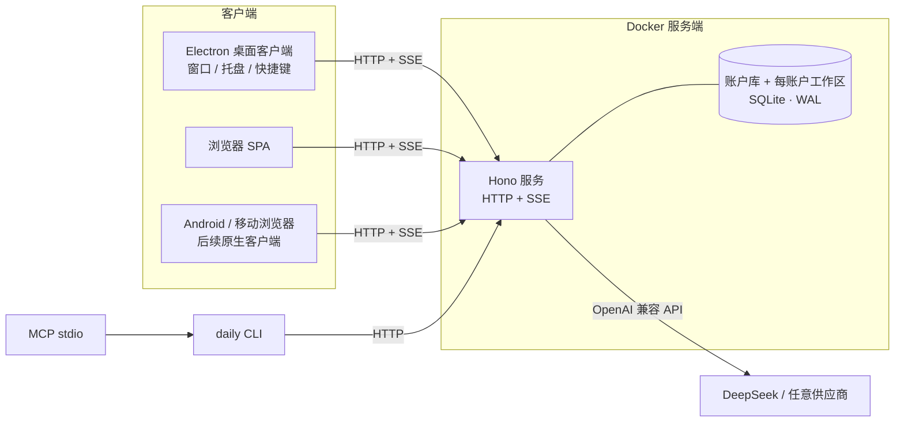

# 架构总览

状态：v0.2.0 实现基线 · 更新：2026-10-27 · 飞书归档：[06 架构](https://my.feishu.cn/docx/Ox4qdSMrKo6OxtxwNNscr8SanGh)

## 1. 运行时拓扑

- **唯一写入口**：服务端 ops 执行器；桌面、浏览器、Android、CLI、MCP 与 AI 都通过 `POST /api/ops/<name>` 调用。
- **生产形态**：Docker 容器运行 Hono 服务与 Web 静态资源，SQLite 数据在 `/data` volume；反向代理终止 TLS。
- **桌面形态**：Electron 只做客户端，读取 `DAILYWORK_SERVER_URL` 或 `connection.json` 后直接加载服务端页面；不启动内置服务，不保存业务数据库。
- **开发形态**：`pnpm dev` 启动 tsx 服务（47821）、Vite（5173）与 Electron；Vite 代理 `/api`。开发数据和生产服务端数据分离。
- **单实例服务**：服务把 `{url, port, token, pairingCode, pid}` 写入 `<dataDir>/runtime.json`（0600）；CLI 先探测健康，再决定复用或拉起 headless 服务。当前是单服务端写模型，不对同一 `/data` 启动多个副本。
- **账户与会话**：服务端 `accounts.sqlite` 保存 users/sessions（scrypt 密码、HttpOnly 会话 cookie）；每个账户使用独立 `users/<userId>/data.sqlite`，所有客户端通过 `/api/auth/*` 登录后共享同一账户数据。Android 原生客户端后续复用同一会话/令牌接口。

## 2. DDD 限界上下文

| 上下文 | 包 | 职责 | 关键对象 |
|---|---|---|---|
| workspace | `packages/contexts/workspace` | 空间、设置、默认空间 | Space, Settings |
| tasking | `packages/contexts/tasking` | 任务、子任务、状态机、标签、日期与预估（唯一所有者） | Task, Tag |
| projects | `packages/contexts/projects` | 项目、交付成果、任务模板 | Project, Deliverable, Template |
| capture | `packages/contexts/capture` | 速记、收件箱捕获、转任务 | Memo |
| planning | `packages/contexts/planning` | 日历事件、时间轴、容量、周复盘、例程 | CapacityDay, Routine |
| focus | `packages/contexts/focus` | 专注会话、统计 | FocusSession |
| documents | `packages/contexts/documents` | 文档树、正文、反向链接 | Document, DocumentBody |
| assistant | `packages/contexts/assistant` | 供应商配置、对话存储、LLM 客户端 | Provider, Conversation, Message |

支撑子系统：`packages/analytics`（跨表只读投影：仪表盘与全局搜索）、`packages/attachments`（blob/附件）、`packages/platform`（数据库、迁移、路径、时间、密钥、备份、日志）、`packages/ops`（操作目录）。

**规则**：跨上下文只调用公开应用函数，不跨包写表；`analytics` 与 `attachments` 是明确的只读/横向支撑例外；依赖方向由目录结构约束，代码评审检查。

## 3. 请求与数据流

### 3.1 命令

1. 客户端 `POST /api/ops/task.create`，body 含业务字段与可选 `opId`。
2. HTTP 层做鉴权（会话 cookie / 服务端 Bearer / TLS 代理）、`confirm` 校验、`opId` 生成。
3. `runOp` 用 zod 校验输入；若 `op_log` 已有同一 `opId`，直接返回 `after_json`（幂等）。
4. handler 在 `BEGIN IMMEDIATE` 事务内写业务表，并调用 `recordOp` 写 `op_log`（同事务）。
5. 成功后通过 SSE `/api/events` 广播 `{type:'op', command}`；所有 Web 查询失效重取。

### 3.2 查询

查询 op（`kind:'query'`）不写 `op_log`，默认有分页 / limit 上限。今天页与仪表盘是读模型：组合多个上下文查询，不持有状态。

### 3.3 AI

AI 面板 → `/api/ai/chat/stream`（SSE）→ assistant 上下文拼系统提示与工具 schema → 供应商流式返回 content/tool_calls → ops 执行器递归执行工具（actor=ai）→ 工具结果回填 → 最终文本落库为 `ai_messages`。CLI/MCP 使用非流式 `ai.chat` op。只读工具自动执行；变更需 UI 开关；破坏性操作永远返回 `CONFIRM_REQUIRED`。任务抽屉、文档工具栏与周复盘通过 `openAi({context,draft})` 预填上下文。

## 4. 存储与同步

- 数据全部在服务端 SQLite（WAL）。客户端不持有业务数据库；多端通过同一个服务端读写，不在客户端之间同步文件。
- 图片：`blobs` 存 BLOB、sha256 唯一、引用计数；`attachments` 多态关联 task/document/memo；删除附件递减引用，零引用即回收。文档正文以 `attachment://<id>` 或附件 URL 引用。
- 审计：`op_log` 是操作日志、活动记录与导出重放底稿，记录 `before_json`/`after_json`；任务级「撤销上一步」用 before 快照恢复。多端通过服务端 SSE 刷新，不做客户端之间的文件级合并。
- 备份：`VACUUM INTO` 快照 + `.dailywork` zip（manifest + data.sqlite + README）；导入先 `PRAGMA integrity_check` 与 schema 版本检查，暂存 `data.sqlite.import-pending`，下次启动原子替换并备份当前库。
- 迁移：`schema_migrations` + 顺序 SQL；已应用 v1（完整 schema）、v2（回填 `completed_at`）。迁移在单事务内执行。

## 5. 安全

- Electron：contextIsolation、sandbox、无 nodeIntegration、preload 白名单；阻止窗口内导航到外站，外链交给系统浏览器。
- 服务端：容器监听 0.0.0.0；服务器部署模式允许远程登录，默认只允许创建首个账户，`DAILYWORK_OPEN_REGISTRATION=1` 才继续公开注册。
- LAN：6 位配对码（10 分钟 10 次限流）换 HttpOnly cookie；Bearer token 亦可；生产静态 HTML 带 CSP（`default-src 'self'`、`object-src 'none'`）。
- 密钥：AI Key 用 AES-256-GCM 加密，密钥文件 `<dataDir>/secrets.key` 0600；日志不写正文与密钥。
- 无遥测、无外部字体/CDN；所有资源随包分发。

## 6. 关键页面与前端状态

- TanStack Router 代码式路由：`/today`、`/inbox`、`/tasks`、`/board`、`/calendar`、`/timeline`、`/focus`、`/docs`、`/docs/$docId`、`/memos`、`/dashboard`、`/projects/$projectId`、`/settings`、`/design`。
- TanStack Query：所有数据经 ops；SSE 收到 command 后统一 `invalidateQueries`。
- Zustand：`ui`（抽屉、面板、侧栏、新任务弹窗）、`timer`（服务端会话 + 前端秒表）、`toast`。
- 主题：设置里的 accent / semantic / neutral / density 运行时写入 CSS 变量与 `data-*` 属性；明暗由 `data-theme` 切换。
- 专注计时以服务端 `startedAt` 为准，刷新可恢复；6 小时未结束的 running 会话在启动时自动取消。

## 7. 与早期方案的差异

| 原方案 | 当前实现 | 原因 |
|---|---|---|
| 每台设备一份数据库 | 单 Docker 服务端 + 多客户端 | 多端必须共享账户与数据；客户端不保存业务库 |
| better-sqlite3 + Drizzle | Node 内置 `node:sqlite` + 手写 SQL | 免原生编译与 Electron ABI 重建，打包稳定 |
| TipTap + Yjs CRDT | TipTap JSON 持久化 | 首期个人使用；避免双写与 CRDT 复杂度 |
| FullCalendar / ECharts | 自绘月/周/日、时间轴、SVG 图表 | 主题与排版完全可控、体积更小；图表需求简单 |
| 每日自动快照 | 启动时生成当日 `.dailywork` 快照并保留 14 份 | 已实现 |
| 流式 AI | SSE 流式请求（start / delta / done） | 已实现；CLI/MCP 使用非流式 `ai.chat` |

## 8. 部署与未来联网

Docker 服务端是唯一权威实例（服务 + Web + SQLite + `/data` 卷），由反向代理终止 TLS。桌面 Electron、浏览器与后续 Android 客户端都连接该服务端；桌面端不启动内置服务。多端共享账户与数据，客户端页面刷新依赖 SSE 与查询缓存。

## 9. 已知限制

- 客户端没有离线业务库；服务端不可达时不能编辑数据（后续可做只读缓存/离线队列）。
- 局域网 HTTPS 证书与移动端信任仍可能受平台限制。
- Electron 为 ad-hoc 签名；首次打开需右键打开或系统设置放行，更新为手动 dmg。
- 日历 / 时间轴暂不支持拖拽改期；可在抽屉中改日期。
- 空间级禁止 AI、全局撤销、Developer ID 公证、真机 iPhone 验收仍需外部条件（见 backlog）。
