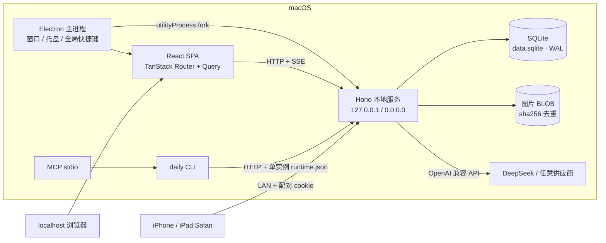

# 架构总览

状态：v0.1.0 实现基线 · 更新：2026-10-27 · 飞书归档：[06 架构](https://my.feishu.cn/docx/Ox4qdSMrKo6OxtxwNNscr8SanGh)

## 1. 运行时拓扑

- **唯一写入口**：服务端 ops 执行器；Web / CLI / MCP / AI 都通过 `POST /api/ops/<name>`。
- **生产形态**：Electron 用 `utilityProcess` 启动打包后的 `resources/server/server.mjs`，服务监听 `0.0.0.0`（局域网请求默认被设置开关拦截），用 `resources/web` 托管同源静态文件。
- **开发形态**：`pnpm dev` 启动 tsx 服务（47821）、Vite（5173）与 Electron；Vite 代理 `/api`。
- **单实例**：服务把 `{url, port, token, pairingCode, pid}` 写入 `<dataDir>/runtime.json`（0600）；token 持久化在 `<dataDir>/server-token`，CLI 先探测健康，再决定复用或拉起 headless 服务。

## 2. DDD 限界上下文

| 上下文 | 包 | 职责 | 关键对象 |
|---|---|---|---|
| workspace | `packages/contexts/workspace` | 空间、设置、默认空间 | Space, Settings |
| tasking | `packages/contexts/tasking` | 任务、子任务、状态机、标签、日期与预估（唯一所有者） | Task, Tag |
| projects | `packages/contexts/projects` | 项目、交付成果、任务模板 | Project, Deliverable, Template |
| capture | `packages/contexts/capture` | 速记、收件箱捕获、转任务 | Memo |
| planning | `packages/contexts/planning` | 日历事件、时间轴、容量、周复盘、例程 | CapacityDay, Routine |
| focus | `packages/contexts/focus` | 专注会话、统计 | FocusSession |
| documents | `packages/contexts/documents` | 文档树、正文、反向链接 | Document, DocumentBody |
| assistant | `packages/contexts/assistant` | 供应商配置、对话存储、LLM 客户端 | Provider, Conversation, Message |

支撑子系统：`packages/analytics`（跨表只读投影：仪表盘与全局搜索）、`packages/attachments`（blob/附件）、`packages/platform`（数据库、迁移、路径、时间、密钥、备份、日志）、`packages/ops`（操作目录）。

**规则**：跨上下文只调用公开应用函数，不跨包写表；`analytics` 与 `attachments` 是明确的只读/横向支撑例外；依赖方向由目录结构约束，代码评审检查。

## 3. 请求与数据流

### 3.1 命令

1. 客户端 `POST /api/ops/task.create`，body 含业务字段与可选 `opId`。
2. HTTP 层做鉴权（loopback / LAN cookie / Bearer）、`confirm` 校验、`opId` 生成。
3. `runOp` 用 zod 校验输入；若 `op_log` 已有同一 `opId`，直接返回 `after_json`（幂等）。
4. handler 在 `BEGIN IMMEDIATE` 事务内写业务表，并调用 `recordOp` 写 `op_log`（同事务）。
5. 成功后通过 SSE `/api/events` 广播 `{type:'op', command}`；所有 Web 查询失效重取。

### 3.2 查询

查询 op（`kind:'query'`）不写 `op_log`，默认有分页 / limit 上限。今天页与仪表盘是读模型：组合多个上下文查询，不持有状态。

### 3.3 AI

AI 面板 → `/api/ai/chat/stream`（SSE）→ assistant 上下文拼系统提示与工具 schema → 供应商流式返回 content/tool_calls → ops 执行器递归执行工具（actor=ai）→ 工具结果回填 → 最终文本落库为 `ai_messages`。CLI/MCP 使用非流式 `ai.chat` op。只读工具自动执行；变更需 UI 开关；破坏性操作永远返回 `CONFIRM_REQUIRED`。任务抽屉、文档工具栏与周复盘通过 `openAi({context,draft})` 预填上下文。

## 4. 存储与同步

- 数据全部在 SQLite（WAL）。**不使用 iCloud / 云同步**（2026-10-27 决策，见 ADR-0003）。
- 图片：`blobs` 存 BLOB、sha256 唯一、引用计数；`attachments` 多态关联 task/document/memo；删除附件递减引用，零引用即回收。文档正文以 `attachment://<id>` 或附件 URL 引用。
- 审计：`op_log` 是操作日志、活动记录与导出重放底稿，记录 `before_json`/`after_json`；任务级「撤销上一步」用 before 快照恢复。**不实现 HLC / deviceId / 墓碑 / 多设备合并**（单 Mac，已取消同步）。
- 备份：`VACUUM INTO` 快照 + `.dailywork` zip（manifest + data.sqlite + README）；导入先 `PRAGMA integrity_check` 与 schema 版本检查，暂存 `data.sqlite.import-pending`，下次启动原子替换并备份当前库。
- 迁移：`schema_migrations` + 顺序 SQL；已应用 v1（完整 schema）、v2（回填 `completed_at`）。迁移在单事务内执行。

## 5. 安全

- Electron：contextIsolation、sandbox、无 nodeIntegration、preload 白名单；阻止窗口内导航到外站，外链交给系统浏览器。
- 本地：服务默认监听 loopback（打包版为支持 LAN 监听 0.0.0.0，但非本机请求在 `lanEnabled=false` 时 403）。
- LAN：6 位配对码（10 分钟 10 次限流）换 HttpOnly cookie；Bearer token 亦可；生产静态 HTML 带 CSP（`default-src 'self'`、`object-src 'none'`）。
- 密钥：AI Key 用 AES-256-GCM 加密，密钥文件 `<dataDir>/secrets.key` 0600；日志不写正文与密钥。
- 无遥测、无外部字体/CDN；所有资源随包分发。

## 6. 关键页面与前端状态

- TanStack Router 代码式路由：`/today`、`/inbox`、`/tasks`、`/board`、`/calendar`、`/timeline`、`/focus`、`/docs`、`/docs/$docId`、`/memos`、`/dashboard`、`/projects/$projectId`、`/settings`、`/design`。
- TanStack Query：所有数据经 ops；SSE 收到 command 后统一 `invalidateQueries`。
- Zustand：`ui`（抽屉、面板、侧栏、新任务弹窗）、`timer`（服务端会话 + 本地秒表）、`toast`。
- 主题：设置里的 accent / semantic / neutral / density 运行时写入 CSS 变量与 `data-*` 属性；明暗由 `data-theme` 切换。
- 专注计时以服务端 `startedAt` 为准，刷新可恢复；6 小时未结束的 running 会话在启动时自动取消。

## 7. 与 v1.0 原方案的差异

| 原方案 | 当前实现 | 原因 |
|---|---|---|
| iCloud 同步 / op_log 多设备合并 | 本地 SQLite + 备份导出导入 | 用户 2026-10-27 取消 iCloud；单 Mac |
| better-sqlite3 + Drizzle | Node 内置 `node:sqlite` + 手写 SQL | 免原生编译与 Electron ABI 重建，打包稳定 |
| TipTap + Yjs CRDT | TipTap JSON 持久化 | 首期单用户；避免双写与 CRDT 复杂度 |
| FullCalendar / ECharts | 自绘月/周/日、时间轴、SVG 图表 | 主题与排版完全可控、体积更小；图表需求简单 |
| 每日自动快照 | 启动时生成当日 `.dailywork` 快照并保留 14 份 | 已实现 |
| 流式 AI | 非流式请求（90s 超时） | 先保证工具调用与护栏；流式列入 v1.1 |

## 8. 已知限制

- 局域网 HTTP 下 Service Worker 不注册（平台安全上下文要求）；可在设置中生成自签名 HTTPS 证书（固定端口 47822），手机信任证书后启用离线壳；真机需手动信任。
- Electron 为 ad-hoc 签名；首次打开需右键打开或系统设置放行，更新为手动 dmg。
- 日历 / 时间轴暂不支持拖拽改期；可在抽屉中改日期。
- 空间级禁止 AI、全局撤销、Developer ID 公证、真机 iPhone 验收仍需外部条件（见 backlog）。
