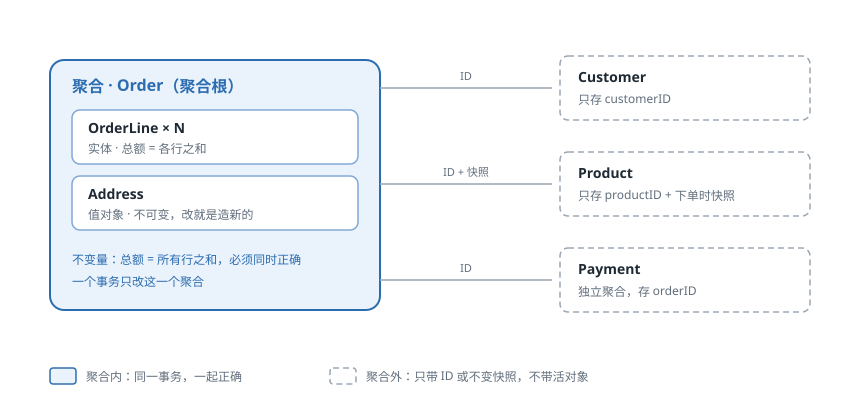
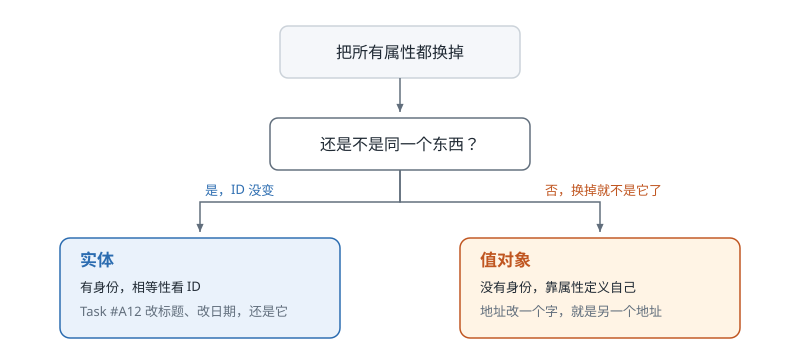
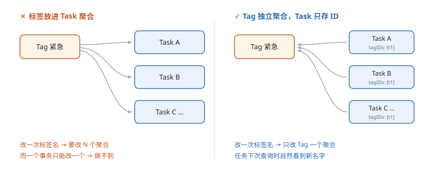

# 第 5 课：战术设计

> 状态：已讲完，检查题已答
> 外部案例：Vaughn Vernon《Effective Aggregate Design》里的订单与订单行
> 关键词：实体、值对象、聚合、不变量、领域事件

## 1. 现实问题：一个订单，一千行

前四课在画小区：哪几块地、每块地什么规矩、地之间怎么走。

这一课开始画房子内部：一个“订单”到底长什么样，哪些东西必须放在一起，哪些必须分开。

Vaughn Vernon 在 2010 年的《Effective Aggregate Design》里用订单举例。团队最初的画法很自然：

- `Order` 是聚合根。
- `OrderLine`（订单行）放在 `Order` 里面，是个集合。
- `Payment`（支付记录）也在里面。
- 还直接持有 `Customer` 和 `Product` 对象。

看起来很符合直觉：这些东西都属于一张订单。

问题在大订单上暴露：

- 每次要改地址，也得把上千行订单行全部读进内存，因为“它们是一个对象”。
- 两个人同时操作，一个加一行、一个改地址，都要锁同一条订单记录，冲突、重试、死锁。
- 一张订单能长到几十 MB，缓存和序列化都变得很难受。
- `Product` 对象塞在订单里，商品改名或改价，历史订单跟着变，可历史订单本该记录下单那一刻的事实。

最根本的问题不是性能，是**边界画错了**：这些对象被放进同一个聚合，但它们并不需要在同一个事务里一起变。

## 2. 解决方式：先问不变量，再画边界

Vernon 给的顺序不是“看哪些对象像一家人”，而是先问一句：**什么东西必须同时正确？**

他的三条规则（原文表述）：

1. **在一个一致性边界内建模真正的不变量。** 只有必须时刻保持一致的东西，才放进同一个聚合。
2. **设计小聚合。** 聚合越大，加载、锁、并发冲突的成本越高。
3. **通过身份引用其他聚合。** 不持有别的聚合的对象，只存 ID。
4. **一个事务只改一个聚合。**

套到订单上：

| 对象 | 放哪 | 理由 |
|---|---|---|
| `OrderLine` | 放在 `Order` 里 | “订单总额 = 所有行之和”必须时刻成立，只能同一事务保证 |
| `Address` | 放在 `Order` 里，当值对象 | 收货地址是订单自己的数据，改了就是另一个地址，不需要独立身份 |
| `Customer` | 只存 `customerID` | 客户改名不该影响订单；客户有自己的生命周期 |
| `Product` | 只存 `productID` + 下单时的名称和价格快照 | 商品会改价改名，订单要保留“下单那一刻”的事实 |
| `Payment` | 独立聚合，存 `orderID` | 支付的到账是异步的，和改订单行不在一个事务 |

注意第三条里的快照：它不是为了性能，是为了**记录事实**。下单时的价格是值对象，之后商品怎么改都和它无关。

这就是所谓“引用别的聚合”：**只带 ID，或者带一份不会变的快照，绝不带一个会变的活对象。**

## 3. 概念：五个积木

战术设计就是这几样东西。先记判断方法，再记名字。

### 实体（Entity）

**有身份，身份不变，属性可变。**

判断方法：把所有属性都换掉，它还是不是同一个东西？

- 一个人改了名字、换了工作、搬了家，还是同一个人。→ 实体。
- 一个任务改了标题、改了截止日期，还是同一个任务。→ 实体。

实体的相等性看 ID，不看字段。

### 值对象（Value Object）

**没有身份，由属性值定义，不可变。**

判断方法：两个对象的属性完全一样，能不能互换，没人能发现？

- 一百块钱就是一百块钱，谁给的都一样。→ 值对象。
- 一个地址就是“省市区街道门牌”，两份一样的地址互换没有区别。→ 值对象。
- 一个时间段、一个金额、一个邮箱地址、一个下单价格快照。→ 值对象。

值对象要**不可变**：想改就造一个新的。这样它永远不会被远处的代码偷偷改掉。

### 聚合（Aggregate）与聚合根（Aggregate Root）

**聚合是一致性的边界：外面只能通过聚合根访问里面的东西，一个事务只改一个聚合。**

聚合根是这个聚合的唯一入口，负责守住不变量。

三个要点：

- 外部只能拿到聚合根，不能直接拿里面的对象改。
- 事务边界 = 聚合边界，不是“页面保存时涉及的几张表”。
- 聚合之间只存 ID，不存对象引用。

### 领域事件（Domain Event）

**已经发生的事实，用过去式命名。**

`TaskCompleted`、`OrderSubmitted`。它记录“发生了什么”，不是“请做什么”（那是命令）。

事件的意义：跨聚合、跨上下文的事情，不靠同一个事务强一致，靠事件最终一致。

### 仓储（Repository）

**按聚合根存取，一个聚合一个仓储。**

`TaskRepository` 负责整个 Task 聚合的读取与保存；不要在仓储里给 `TaskLine` 开一个 `SaveLine()`——那说明你想绕过聚合根。

### 领域服务（Domain Service）

规则不属于任何单个对象、又需要协调多个对象时，才建领域服务。它没有状态，只放规则。

大多数规则都该落在实体或值对象里。领域服务是例外，不是默认。

## 4. 理论：聚合不是打包，是保护不变量

初学者最容易犯的错，是把“关联紧密”当成“同一个聚合”。真正的判据只有一条：

> 这两样东西，必须永远同时正确吗？如果一边对了、另一边错了，业务上能接受吗？

- 订单总额和订单行：不能接受不一致 → 同一个聚合。
- 任务状态和完成时间：不能接受 `done` 却没有 `completedAt` → 同一个聚合。
- 任务和它的标签：标签改名了、任务还是那个任务 → 不同聚合。

聚合越大，代价越高：

- 加载成本：改一个字段要把整个聚合读出来。
- 并发冲突：两个人改聚合里不相干的部分，也会撞车。
- 事务时间：事务越长，锁越久，吞吐越低。

所以原则是**尽量小**：只装真正需要一起正确的东西，其他一律用 ID 引用。

反面教材是贫血模型（Martin Fowler, 2003）：对象只有 getter / setter，规则全在 service 里。后果是规则散落、无法保证不变量、任何人都能在任何地方改坏状态。

一个实用判断：如果你能写出 `task.Status = "done"` 这种赋值，却不清楚 `completedAt` 有没有被一起设置，那这个聚合没有守住自己的不变量。

## 5. 闭环：我们项目的 Task 聚合

按上面的判据过一遍。

**Task 是聚合根**，聚合内部包含：

- 身份：`TaskID`
- 值对象：`Title`（非空、长度上限）、`Estimate`（分钟数 ≥ 0）、`Priority`、`Status`、日期范围（`scheduledDate` / `dueDate`）
- 普通字段：`notes`、`actualMinutes`

**必须在同一个事务里保证的不变量**：

- `status = done` ⇔ `completedAt ≠ nil`（`Complete()` 写时间，`Reopen()` 清时间）
- 子任务的 `spaceID` / `projectID` 必须和父任务一致
- 只有 `done` 可以 `Reopen`
- 优先级、状态取值只能来自枚举

这些不变量决定了：`status`、`completedAt`、`spaceID`、`projectID`、`parentID` 必须在聚合里，由聚合根改。

**聚合外，只存 ID**：

| 外部对象 | 怎么处理 | 为什么 |
|---|---|---|
| `Project` | `projectID` | 项目归档是项目自己的事，不改变任务不变量 |
| `Space` | `spaceID` | 同上 |
| `Tag` | `tagIDs` | 标签是共享的，改名不该动任务 |
| 用户 | `ownerID` | 账号在 identity，任务只引用 |

**领域事件**（已发生的事实）：

- `TaskCreated`、`TaskCompleted`、`TaskReopened`、`TaskRescheduled`、`TaskDeleted`
- 它们进 outbox，和业务写入同一个事务，再由 relay 投到 Kafka。

**仓储**：

- `TaskRepository`、`ProjectRepository`、`SpaceRepository`、`TagRepository`，一个聚合根一个。
- 仓储接口放在 domain 层，实现放在 adapters，用 GORM。

一句话：

> 聚合的边界由不变量决定，不由“看起来属于一起”决定；跨聚合只带 ID，跨上下文只带事件。

## 检查题

1. 订单里，`OrderLine` 有 ID、能改数量和单价；`Address` 没有 ID，改了就是另一个地址。用一句话分别说出判断依据。
2. 下单时的商品价格，应该只存 `productID`，还是连名称和价格一起存快照？用“谁拥有这份数据”和“它会不会变”说理由。
3. 如果 `Tag` 放进 `Task` 聚合里，给一个标签改名，要动多少个 Task 聚合？这说明聚合边界应该怎么划？

## 本课总结

- 实体看身份，值对象看值；判据是“换掉所有属性，还是不是同一个东西”。
- 聚合是一致性边界和事务边界：一个事务只改一个聚合，外部只能通过聚合根访问。
- 聚合的边界由不变量决定，不由关联紧密度决定；聚合越小，加载和并发成本越低。
- 跨聚合只引用 ID，或引用一份不会变的快照；跨上下文用领域事件。
- 贫血模型把规则和状态拆开，等于放弃保护不变量。

**关键词**：实体、值对象、聚合、不变量、领域事件。

## 来源

- [Vaughn Vernon: Effective Aggregate Design](https://www.dddcommunity.org/library/vernon_2011/)
- [Martin Fowler: AnemicDomainModel](https://martinfowler.com/bliki/AnemicDomainModel.html)
- [Domain Language: DDD Reference](https://www.domainlanguage.com/ddd/reference/)
