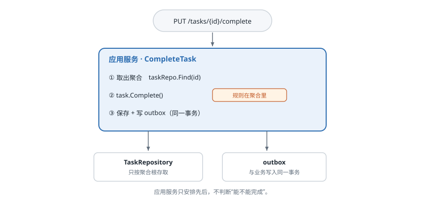
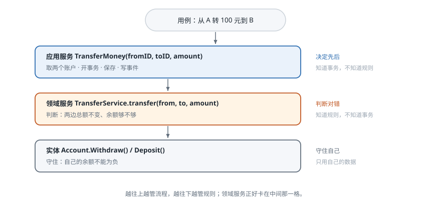
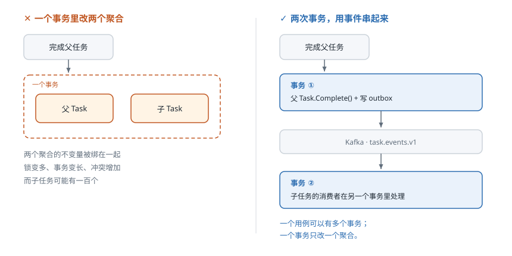
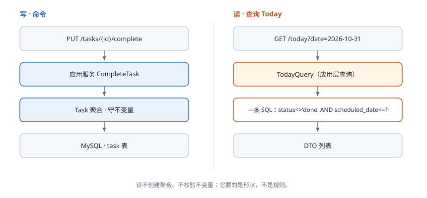

# 第 6 课：应用层

> 状态：已讲完，检查题已答
> 外部案例：Martin Fowler《企业应用架构模式》里服务层的由来
> 关键词：用例、应用服务、事务边界、跨聚合编排、读模型

## 1. 现实问题：一个操作，三个地方三种结果

前五课把边界和模型都定完了。这一课问一个更小、但更容易出错的问题：

> **一次操作，代码到底写在哪？**

我们自己的场景。勾选父任务"完成"的时候，它下面的子任务要不要跟着完成？

如果没人规定过，你会在三个地方看到三种答案：

- 前端：勾选父任务时顺手把子任务的勾也打上，因为"看起来应该一起"。
- 后端 API：只改父任务的 `status`，因为"这个接口只管这一个资源"。
- 定时任务：每天扫过期任务时把父任务和子任务一起标完成，因为"清理要彻底"。

结果：同一天，同一个人，在网页上完成父任务，子任务是完成的；在手机上完成同一个父任务，子任务还是未完成。

这不是哪个地方写错了。是**这条规则从来没有归属**。

## 2. 外部案例：服务层是怎么来的

Martin Fowler 在 2002 年的《企业应用架构模式》里描述了同一类问题的早期版本。

**背景**：那时候企业应用普遍是多个客户端加一个数据库——桌面客户端、Web 客户端、批处理各自直连数据库，业务逻辑经常就写在界面事件里。

**场景**：同一个"下单"操作，桌面端实现一遍，Web 端再实现一遍，批处理脚本第三遍。

**后果**：三份实现开始分叉。改了一条规则，只改到了其中两处；第三处还按老规则跑。测试也没法只测规则，得从界面点起。

他的解法是加一层**服务层**（Service Layer）：

> 定义应用的一个边界，用一组服务来承载每个可用操作，并在每个操作里协调应用的响应。

翻译成一句话：**每个操作只写一次，写在服务层里，客户端只负责调。**

这个位置，在今天的 Go 项目里，就是我们说的**应用层**。

## 3. 解决方式：给"一次操作"找一个家

先别问"代码写哪层"，先问：**用户这一次想做成什么？**

"把任务 A 标记完成"是一件事，从请求进来到响应返回，中间所有步骤都属于它。这件事有个名字：**用例**。

用例需要一个落脚点，这个落脚点叫**应用服务**。

应用服务只做三件事，而且只做这三件：

1. **取**：按 ID 把需要的聚合取出来。
2. **判**：调用聚合上的方法，让聚合自己判断。
3. **存**：保存聚合，并在同一个事务里写下要发的事件。

它不判断"能不能完成"——那是 Task 聚合的事。它只安排先后。



## 4. 概念

### 用例（Use Case）

**一次从入口到结束的完整操作，对应一个用户意图。**

命令是改动（完成任务、改期），查询是读取（今天的任务）。一个用例对应一个应用服务方法，不多不少。

判断粒度：换一个入口——网页、手机、定时任务、AI 工具调用——这件事还是不是同一件事？是，它就是一个用例。

### 应用服务（Application Service）

**用例的实现，负责顺序、边界和协作。**

它做什么：

- 从仓储取聚合、调用领域方法、保存。
- 决定事务从哪开始、到哪结束。
- 写 outbox、发事件、调外部端口。
- 做鉴权：这个用户能不能操作这个资源。

它不做什么：

- 不判断业务对错。"只有 `done` 才能 `Reopen`" 不在这一层。
- 不写 SQL，不出现 GORM、BSON、HTTP 类型。
- 不直接拼给前端的返回结构，那是适配器的事。

**应用服务 vs 领域服务**，这两个最容易混：

| | 应用服务 | 领域服务 |
|---|---|---|
| 面向 | 一个用例 | 一条规则 |
| 有没有事务 | 有，它定边界 | 没有，它不知道事务存在 |
| 能不能碰仓储 | 能，它就是来取聚合的 | 一般不能 |
| 例子 | `CompleteTask` | `判断子任务能否继承父任务的日期` |

### 领域服务

**一条领域规则，但不属于任何单个对象，所以单独放一个服务。**

它做的事：同时看几个对象，算出一个判断或结果。
它不知道的东西：事务、仓储、HTTP、DTO。



三个判据，全中才是领域服务（Vernon《实现领域驱动设计》）：

1. 它表达的是领域概念，不是技术概念——"算今日权重"是，"发邮件"不是。
2. 它要用到领域模型里的其他对象，不是只用自己。
3. 它没有状态。

转账是最经典的例子：从 A 扣、给 B 加、两边总额不变——这条规则不属于 A，也不属于 B，所以它站不到任何一个实体身上。

**它是例外，不是默认。** 先在实体和值对象里找位置，实在找不到才建服务。规则被随手丢进服务，就和丢进应用服务一样，是不变量失守的开始。

### 事务边界

**一个事务只改一个聚合。** 这条第 5 课定了，这里补上它在应用层的含义：

- 一个用例**不等于**一个事务。一个用例可以有零个、一个或多个事务。
- 需要改两个聚合时，不是把事务变大，而是拆成两段，用事件串起来。
- 如果一个用例非要在同一事务里改两个聚合，先回头看看边界是不是画错了。



### 跨聚合编排

**应用服务负责"先做 A，再做 B"，但每一段都在自己的事务里。**

顺序是固定的：

1. 本地事务：改聚合，并在同一事务里写 outbox。
2. 事务提交后，relay 把 outbox 投到 Kafka。
3. 消费者在自己的事务里处理下游聚合。

第 1 步不能省：**事件必须和业务写入同一事务**。否则只有两种结局——改成功了但事件丢了，或者事件发了但写入回滚了。outbox 的全部意义就在这。

编排分两种：

- 短流程：应用服务直接调下游，同步调用，比如走 Kitex。
- 长流程、多步、要补偿：交给进程管理器 / saga，第 8 课讲。

### 读模型

**查询不复用聚合。**

`Today` 是这一课最容易做错的地方。它看起来像一个"今天"的东西，很容易被建成 `Today` 聚合。它不是。

Today 是一次**查询**：日期小于等于今天、状态不是完成的任务，按项目分组、按截止日排序。它没有状态机、没有不变量、没有"今天能不能改"这种规则。它是数据的一个形状。

所以：

- 查询直接写 SQL，返回 DTO。
- 不加载聚合，不走仓储的聚合接口。
- 不校验不变量——读不改变任何东西。



## 5. 理论：应用层编排，不发明规则

应用层最常见的两个错，方向正好相反。

**错一：应用服务里写业务规则。**

```go
if task.Status == StatusDone {
    return ErrAlreadyDone
}
```

看着没错，但它把"完成"的定义从 Task 里搬走了。明天加一个"已完成任务可以再次完成，用来刷新完成时间"的需求，你要改的是应用服务，不是聚合；再后天换一个入口，又要记得再写一遍。

判断方法：**这条规则，换一个入口还成立吗？** 成立，它就是领域规则，回聚合里去。不成立（比如"网页请求要校验 CSRF"），那才是应用层的事。

**错二：应用服务退化成事务脚本。**

另一种写法是把所有逻辑摊在应用服务里，聚合只剩 getter/setter。Fowler 给这种写法起过名字——**事务脚本**（Transaction Script）。它是贫血模型的另一面：规则还在，只是位置错了，结果是不变量守不住。

一个自检：**应用服务里出现按业务状态做的 `if`，就是信号。** 应用层可以有的条件判断只有流程性的——资源存不存在、参数合不合法、版本对不对——不该有"什么状态能做什么"。

一句话：

> **应用层回答"先做什么、在哪个事务里做"；领域层回答"这样做对不对"。**

## 6. 闭环：我们的用例表

这是本课的产出。

| 用例 | 聚合 | 事务 / 锁 | 领域规则（在聚合里） | 事件 |
|---|---|---|---|---|
| 创建任务 | Task | 一个事务 | 标题非空；子任务的 space / project 与父一致 | `TaskCreated` |
| 完成任务 | Task | 一个事务，乐观锁 `version` | `status=done` ⇔ `completedAt≠nil`；只有未完成能完成 | `TaskCompleted` |
| 重开任务 | Task | 一个事务 | 只有 `done` 能 `Reopen`，并清空 `completedAt` | `TaskReopened` |
| 改期 | Task | 一个事务 | 日期范围合法 | `TaskRescheduled` |
| 删除任务 | Task | 一个事务 | 待定：有子任务时禁止删除，还是级联 | `TaskDeleted` |
| 归档项目 | Project | 一个事务 | 归档不是删除，任务保留 | `ProjectArchived` |
| 列出今天 | 无 | 无事务 | 无，纯查询 | 无 |
| 列出项目下任务 | 无 | 无事务 | 无，纯查询 | 无 |

这张表怎么用：

- 一个用例一行，一行只能给出一个"事务"结论。
- 事务列里出现两个聚合，就是红灯。
- 领域规则列必须是聚合自己能判断的。写不进去的，说明它其实是跨聚合流程，去编排那一列。

**Today 的查询**长这样：

```sql
SELECT id, title, status, priority, due_date, project_id
FROM task
WHERE owner_id = ?
  AND status <> 'done'
  AND scheduled_date <= ?
ORDER BY (due_date IS NULL), due_date, priority
```

不加载聚合，不校验不变量，直接给 DTO。

**还没定的一个问题**：完成父任务时子任务怎么处理。三种做法都说得通——跟着完成、只发提醒、什么都不做。这不是应用层能拍板的，是产品规则；要先定下来写进术语表，再落进这张用例表。记在这里，不假装它已经解决。

但**放在哪一层是确定的**：不管最后选哪种做法，都落在应用服务的编排里，靠 `TaskCompleted` 事件驱动子任务，不在 Task 聚合内部做。原因很简单——父任务和子任务是两个独立的 Task 聚合，聚合看不见别的聚合，它没有能力回答"我的子任务现在什么状态"。

## 检查题

1. "完成父任务时，子任务要不要一起完成"这条规则，应该写进 Task 聚合，还是应用服务？说清理由，再说如果你写进聚合会发生什么。
2. 一个用例要同时修改 Task 和 Project（比如把某个项目下所有任务整体改期），你会怎么拆？事务划在哪？
3. 有人提议建一个 `Today` 聚合，把"今天该做什么"提前算好存起来。给出两个反对理由。

## 本课总结

- 用例是"一次操作"，应用服务是它的家：取、判、存三步，不判断业务对错。
- 一个用例不等于一个事务；一个事务只改一个聚合，跨聚合用事件串起来。
- 事件必须和业务写入同一事务（outbox），否则要么丢事件，要么发出假事件。
- 查询不复用聚合；Today 是读模型，是数据的形状，不是一种状态。
- 应用服务里出现按业务状态做的 `if`，就是规则放错层的信号。

**关键词**：用例、应用服务、事务边界、跨聚合编排、读模型。

## 来源

- Martin Fowler《Patterns of Enterprise Application Architecture》(2002)：Service Layer、Transaction Script
- Vaughn Vernon《Effective Aggregate Design》
- Martin Fowler: [CQRS](https://martinfowler.com/bliki/CQRS.html)
- Martin Fowler: [BoundedContext](https://martinfowler.com/bliki/BoundedContext.html)
