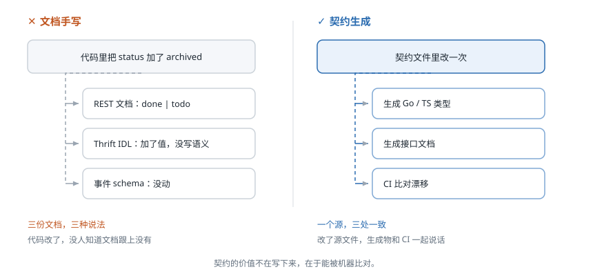
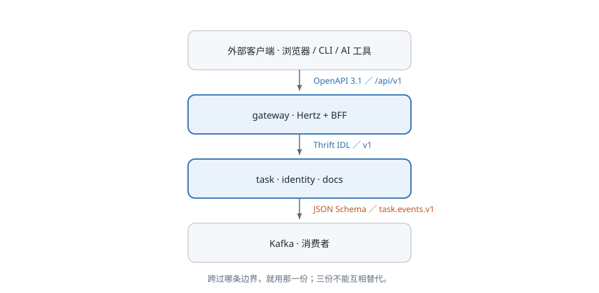
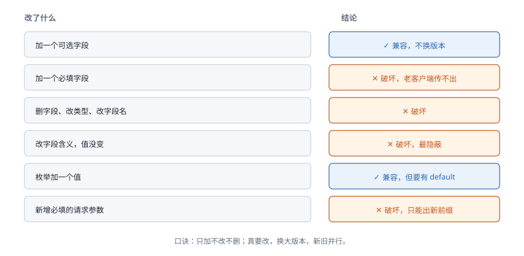

# 第 7 课：契约

> 状态：已讲完，检查题已答
> 外部案例：Kubernetes 的 API 版本与弃用
> 关键词：契约、OpenAPI、Thrift、事件 schema、向后兼容

## 1. 现实问题：一个字段，三处定义

第 6 课把用例收拢进了应用服务，行为一致了。但只要还有一个入口没走同一条路，问题就换个地方冒出来。

场景：`status` 从 `done` 拆成 `done` / `archived`。

- 前端改了自己那份 TS 类型，发了新版。
- REST 文档还写着 `done | todo`，因为它是单独维护的。
- Thrift IDL 只加了枚举值，没写清 `archived` 算不算完成。
- 事件 JSON Schema 没动，消费者按 `done` 判断，把 `archived` 当成了未完成。
- AI 工具读的是另一份 schema 副本。

结果：同一条任务，网页显示"已归档"，SSE 推送说"未完成"，AI 说"这条还没做"。

**不是谁写错了，是同一件事被写了五遍。**

## 2. 外部案例：Kubernetes 移除一个 API 版本

**背景**：Kubernetes 的 API 是版本化的，同一个资源可以同时存在 `v1beta1` 和 `v1` 两份定义。

**场景**：Ingress 这类资源早年在 `extensions/v1beta1` 里，后来进了稳定版。旧版本按计划被移除——集群升级之后，用旧 API 写的清单直接 apply 失败。

**后果**不只是"某个文件不能用了"。所有按旧版本写死的工具、脚本、CI 模板一起失效，而且是**升级那一刻才暴露**——它们之前在旧集群上跑得好好的。

社区的应对不是"以后别改"，而是把规则写死：

- 一个 API 要移除，必须先有稳定的替代版本。
- 必须先公告、先经过弃用期，不能直接消失。
- 稳定版 API 的移除有最小时间要求，不能发了就删。

这条经验放到我们身上就一句话：**改可以，但要留出别人跟上的时间，而且要在契约层面显式声明。**

## 3. 解决方式：契约先于实现

先定一件事：**契约是两个上下文之间那份可验证的形状。**

"可验证"是关键。文档是给人读的，契约是给工具读的——能生成代码、能跑校验、能进 CI。

所以顺序是：

1. 先改契约文件。
2. 再改实现。
3. CI 重新生成，和仓库里的生成代码比对，不一样就失败。



## 4. 概念

### 契约

**两个上下文之间约定的接口形状：字段、类型、必填性、错误码、版本。**

它描述的是"过这条边界时数据长什么样"，不描述边界内部怎么实现。

### Published Language

DDD 的 context map 里有一个模式叫**公开语言**（Published Language）：上游把自己的模型翻译成一份公开的、文档化的语言，下游直接按这份语言理解。

契约就是这份语言的载体。它的意义在于：

> 下游不需要认识上游的模型，只需要认识这份语言。

这也解释了为什么契约要窄——公开语言只说下游需要的部分，不是把上游的家底全抖出来。

### 三种载体，各管一段



| 边界 | 载体 | 我们用什么 |
|---|---|---|
| 外部客户端 ↔ gateway | OpenAPI 3.1 | REST，前缀 `/api/v1` |
| gateway ↔ 内部服务 | Thrift IDL | Kitex，命名空间 `v1` |
| task → Kafka | 事件 JSON Schema | topic `task.events.v1` |

三者不能互相替代。REST 描述的是 HTTP 语义（状态码、分页、错误信封）；Thrift 描述的是 RPC（方法、异常）；事件 schema 描述的是"发生过什么"，没有请求方，也没有响应。

### 版本

- **对外**：主版本进 URL，`/api/v1`。破坏性变更只能出新前缀，不能悄悄改 v1。
- **内部**：IDL 命名空间带版本（`v1`），加字段不换命名空间。
- **事件**：版本进 topic 名（`task.events.v1`）。换大版本就是换 topic，新旧并行一段时间。

### 向后兼容



规则可以压成一句话：**只加不改不删。**

- 加一个可选字段：兼容。老客户端不认识，忽略即可。
- 加一个必填字段：破坏。老客户端传不出来。
- 删字段、改类型、改字段名：破坏。
- **改字段含义但值不变**：破坏，而且最隐蔽——`done` 还是那个 `done`，值没变，语义变了。
- 枚举加一个值：对 JSON 兼容，但消费方必须有 `default` 分支，否则未知值会穿透。

最后一条在 Go 里尤其要注意：`switch` 穷举枚举时，加一个值不会编译报错，只会走默认分支——如果默认分支是"当成未完成"，那 `archived` 就被误判了。

## 5. 理论：契约是边界，不是文档附件

三条。

**一、契约不对称。**

上游定义，下游遵守。下游要翻译就在自己这边加 ACL，不去要求上游为自己改契约。一个上游一份契约，不为每个消费者定制——否则就变成 N 份契约，又回到第 1 节那个局面。

**二、契约要窄。**

只传下游需要的字段。`assistant` 只需要 `taskID`、`title`、`status`，就别把 `notes`、`actualMinutes` 一起给它。

宽契约的代价：上游每加一个字段，下游都以为和自己有关；下游每出一个 bug，都要排查所有字段。

**三、校验在 CI，不在人。**

契约的价值在于能被机器检查。没有生成、没有漂移检查的契约，就是一份会过期的文档——和手写文档没有区别。

## 6. 闭环：我们的三份契约

**事件信封**（所有事件共用）：

```json
{
  "eventId": "uuid",
  "eventType": "task.completed",
  "version": 1,
  "occurredAt": "2026-10-31T02:00:00Z",
  "aggregateId": "task_xxx",
  "traceId": "...",
  "payload": { "taskID": "...", "completedAt": "..." }
}
```

**变更清单**，以 `status` 拆成 `done` / `archived` 为例：

| 步骤 | 改什么 | 版本动不动 |
|---|---|---|
| 1 | OpenAPI：枚举加 `archived`，字段描述写清语义 | 不动，仍 `/api/v1` |
| 2 | Thrift：枚举加值，所有 `switch` 补 `default` | 不动，仍 `v1` |
| 3 | 事件 schema：`payload.status` 枚举加值 | 不动，仍 `version: 1` |
| 4 | 消费者：把 `archived` 归到"不再活跃"，不是"未完成" | 不动 |
| 5 | CI：生成漂移 + schema 校验 + 契约测试 | — |

**检查什么**：

- 生成代码提交进仓库，CI 重新生成后 `git diff` 必须为空。
- OpenAPI 跑 lint。
- 事件 payload 用 JSON Schema 校验。
- 契约测试：按 OpenAPI 生成请求，打真实服务，断言响应形状。

## 检查题

1. 给 `Task` 的 REST 接口加一个可选字段 `archivedAt`，需要升到 `/api/v2` 吗？说明理由。
2. `task.events.v1` 里要把 `status` 从字符串改成对象 `{code, changedAt}`。这算不算破坏性变更？如果算，你怎么做才能不让老消费者挂掉？
3. 为什么 `assistant` 调 task 时不该直接 import task 的领域模型，而要用一份单独的契约？

## 本课总结

- 契约是两个上下文之间可验证的形状，不是写给人看的文档附件。
- 三份契约各管一段：OpenAPI 管外部 HTTP，Thrift 管内部 RPC，JSON Schema 管事件。
- 兼容的口诀是"只加不改不删"；改类型、改语义、加必填，都要换大版本。
- 契约要窄，一个上游一份；翻译放在下游的 ACL 里。
- 校验在 CI：生成代码进仓库，漂移必须拦住。

**关键词**：契约、OpenAPI、Thrift、事件 schema、向后兼容。

## 来源

- [Kubernetes: Deprecation Policy](https://kubernetes.io/docs/reference/using-api/deprecation-policy/)
- [OpenAPI Specification 3.1](https://spec.openapis.org/oas/v3.1.0)
- [Apache Thrift](https://thrift.apache.org/)
- [JSON Schema](https://json-schema.org/)
- Eric Evans《领域驱动设计》：context map 中的 Published Language
