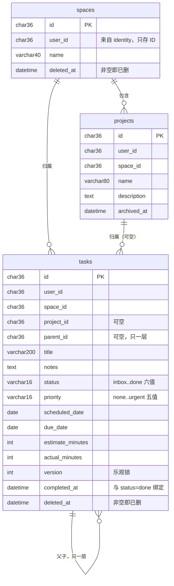

# M1 数据库 ER 图

三张表：`spaces` → `projects` / `tasks`，任务可挂一层子任务。

**图上连线是逻辑关联，不是外键。** 库表不建外键，一致性由应用层保证；
完整字段定义见 [`deploy/mysql/init/02-schema.sql`](../../deploy/mysql/init/02-schema.sql)。

## 几条约束

| 规则 | 落在哪里 |
|---|---|
| 状态只有六个值，没有 `archived` | `chk_tasks_status` |
| 优先级只有五个值 | `chk_tasks_priority` |
| `done` 与 `completed_at` 同时成立 | `chk_tasks_done` |
| 同一用户的活跃空间不重名 | `spaces_active_name_uq` + 生成列 `active_name` |
| 同一空间的活跃项目不重名 | `projects_active_name_uq` + 生成列 `active_name` |
| 任务只做逻辑删除 | `deleted_at`，所有查询过滤 `deleted_at IS NULL` |

## 尚未建的表

`tags`、`task_tags`、`outbox`、`idempotency_keys`、`processed_events` 属于后续切片，
等用到时再加。
